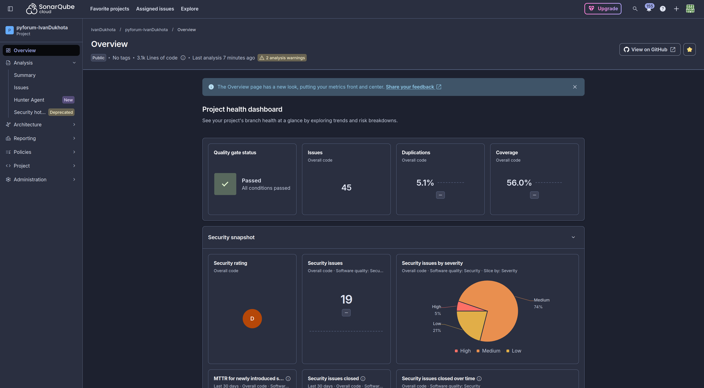
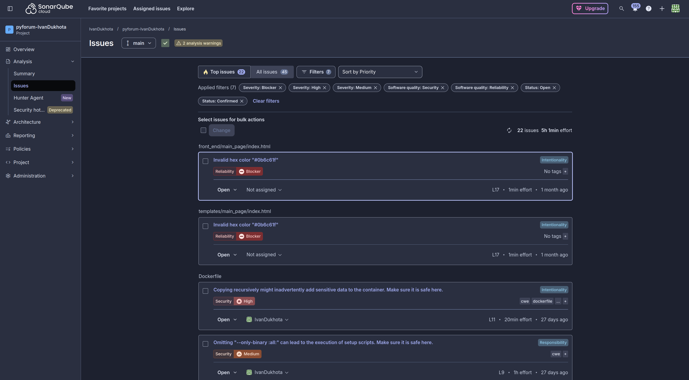
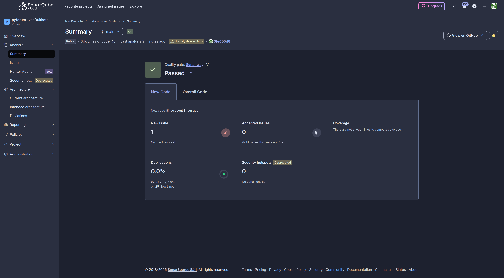

# DevOps Report:

## General Information:

- Period: 02.11.2026 - 03.11.2026;
- Report date: 03.11.2026;
- Author: Ivan Dukhota;
- Project: PyForum;
- Goal: Implement CCI (Continuous Code Inspection);

## Summary:

I added code inspection with SonarCloud (SonarQube Cloud) to the Jenkins pipeline. A new Sonar stage runs after the tests and waits for the quality gate result. If the gate fails, the pipeline stops and the image is not pushed to Docker Hub.

The Test stage now collects test coverage, and SonarCloud shows it together with the other results. Sonar checks not only the Python code but also the Dockerfile, Ansible roles, Terraform files and the Jenkinsfile.

I also fixed the pollSCM trigger from the last report: it is now set in the JCasC job config and stays after Jenkins restarts.

## Goals:

- Main goal: every build is checked by a code analyzer, a bad result stops the pipeline;
- Other goals: test coverage in the analysis, fix of the pollSCM trigger.

## Architecture:

The VMs did not change (lb, app1, app2, db, jenkins). Jenkins pipeline stages:

| Stage | What it does |
| ----- | ------------ |
| Prepare | Copies the .env file from Jenkins credentials |
| Build | Builds the app image |
| Test | Runs Django tests with coverage.py, saves coverage.xml |
| Sonar | Runs sonar-scanner-cli in Docker, sends the analysis to SonarCloud, waits for the quality gate |
| Push | Pushes the image with the commit SHA tag to Docker Hub |
| Cleanup | Keeps the last KEEP_TAGS SHA tags on Docker Hub |

## Task Completed:

| #   | Task | Status | Owner | Finished | Notes |
| --- | ---- | ------ | ----- | -------- | ----- |
| 1   | SonarCloud project | Done | Ivan | 03.11.2026 | Automatic Analysis is off, analysis runs from CI |
| 2   | SonarCloud token in Jenkins | Done | Ivan | 03.11.2026 | Ansible Vault + JCasC credential |
| 3   | Test coverage | Done | Ivan | 03.11.2026 | coverage.py, report coverage.xml |
| 4   | Sonar stage with quality gate | Done | Ivan | 03.11.2026 | sonar-scanner-cli in Docker |
| 5   | Fix of pollSCM trigger | Done | Ivan | 03.11.2026 | Trigger in the JCasC job config |

## Results:

- What I did: SonarCloud analysis in the Jenkins pipeline with a quality gate, test coverage, fix of the pollSCM trigger;
- What I achieved: every build on main is analyzed, the results are on the SonarCloud dashboard, a failed gate blocks the image push.

First analysis results (main branch):
- 3.1k lines of code, coverage 56%, duplications 5.1%;
- 45 issues: 7 bugs, 19 vulnerabilities, 19 code smells;
- security rating D.

Examples of findings:
- Dockerfile: recursive COPY can add sensitive files to the image, pip install without locked hashes;
- Ansible: file permissions give access to others, HTTP instead of HTTPS.

## Problems and Solutions:

| #   | Problem | Solution | Status |
| --- | ------- | -------- | ------ |
| 1   | Jenkins did not start a build after the merge to main (pollSCM, #4 from the last report) | The trigger is set in the JCasC job config, so it stays after Jenkins restarts | Done |
| 2   | The scanner failed with AccessDenied on /tmp/.scannerwork. It runs as the jenkins user, and this folder in the image belongs to another user | The scanner work folder is now in the Jenkins workspace (sonar.working.directory) | Done |
| 3   | The scanner cache was saved in the workspace and got into the Docker build context (308 MB instead of 18 kB), so the pushed image was too big | Scanner folders and coverage.xml are added to .dockerignore | Done |
| 4   | After the merge, polling still checked the deleted feature branch. A Pipeline job polls with the git settings of its last build, and the last build was on the feature branch | One manual build on main | Done |
| 5   | After each Ansible run the first build is UNSTABLE: "KEEP_TAGS must be a positive number". JCasC creates the job again without the parameter from the Jenkinsfile | The parameter will be added to the JCasC job config | Open |

## Next Steps:

- Add the KEEP_TAGS parameter to the JCasC job config;
- Scanning images and dependencies in CI/CD.

## Tools and Technologies Used:

- SonarCloud (SonarQube Cloud): free plan, quality gate "Sonar way";
- sonar-scanner-cli 8.3.1 (Docker image sonarsource/sonar-scanner-cli);
- coverage.py 7.17.0;
- Jenkins 2.580.2: JCasC, Job DSL, declarative pipeline;
- Ansible: role jenkins, Ansible Vault.

## Comments and Conclusions:

The Implement CCI task is done. Code inspection is now a part of the pipeline.