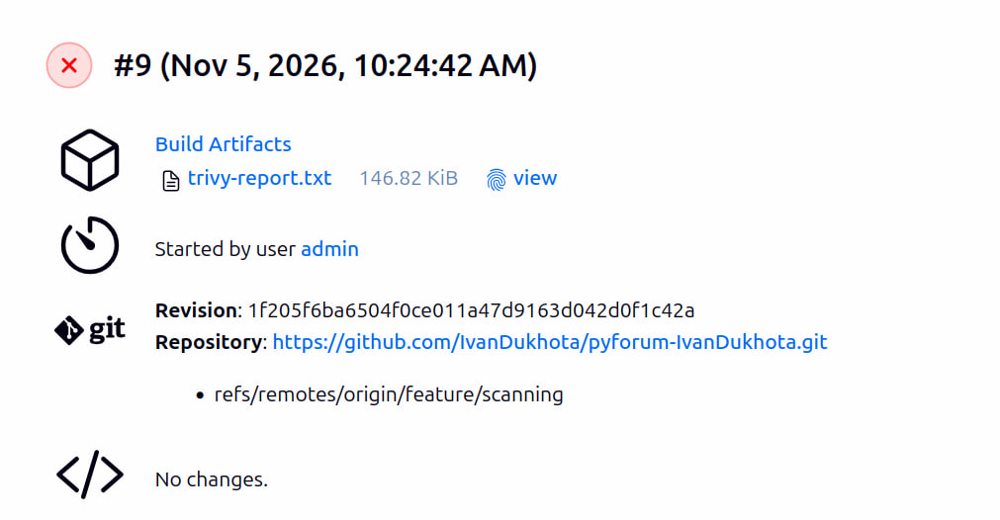
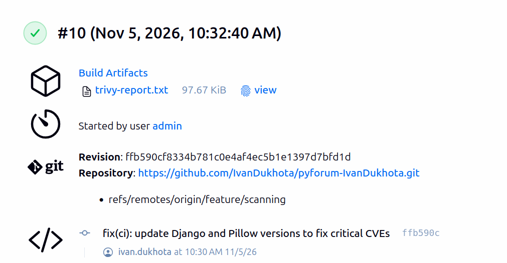

# DevOps Report:

## General Inforamation:

- Period: 04.11.2026 - 05.11.2026;
- Report date: 05.11.2026;
- Author: Ivan Dukhota;
- Project: PyForum;
- Goal: Scanning images and dependencies in CI/CD;

## Summary:

I added image and dependency scanning with Trivy to the Jenkins pipeline. A new Scan stage runs after Sonar and checks the built image: Debian packages and Python packages. If Trivy finds a CRITICAL vulnerability, the pipeline stops and the image is not pushed to Docker Hub. HIGH findings are saved to a report and do not stop the build.

The first scan found 7 CRITICAL vulnerabilities in Django and Pillow. I updated both packages, and the next build passed.

I also fixed the KEEP_TAGS parameter from the last report: it is now set in the JCasC job config.

## Goals:

- Main goal: every image is scanned before the push, a CRITICAL vulnerability stops the pipeline;
- Other goals: fix of the found CRITICAL vulnerabilities, fix of the KEEP_TAGS parameter.

## Architecture:

The VMs did not change (lb, app1, app2, db, jenkins). Jenkins pipeline stages:

| Stage | What it does |
| ----- | ------------ |
| Prepare | Copies the .env file from Jenkins credentials |
| Build | Builds the app image |
| Test | Runs Django tests with coverage.py, saves coverage.xml |
| Sonar | Runs sonar-scanner-cli in Docker, sends the analysis to SonarCloud, waits for the quality gate |
| Scan | Runs Trivy in Docker: saves HIGH and CRITICAL findings to trivy-report.txt, fails on CRITICAL |
| Push | Pushes the image with the commit SHA tag to Docker Hub |
| Cleanup | Keeps the last KEEP_TAGS SHA tags on Docker Hub |

## Task Completed:

| #   | Task | Status | Owner | Finished | Notes |
| --- | ---- | ------ | ----- | -------- | ----- |
| 1   | Fix of KEEP_TAGS parameter | Done | Ivan | 04.11.2026 | Parameter in the JCasC job config |
| 2   | Scan stage with Trivy | Done | Ivan | 05.11.2026 | Trivy 0.76.1 in Docker, DB cache in a Docker volume |
| 3   | Trivy report as build artifact | Done | Ivan | 05.11.2026 | trivy-report.txt, HIGH and CRITICAL |
| 4   | Fix of CRITICAL vulnerabilities | Done | Ivan | 05.11.2026 | Django 4.2.30, Pillow 13.0.0 |

## Results:

- What I did: Trivy scan of the image in the Jenkins pipeline, the build fails on CRITICAL, the report is saved as a build artifact, update of vulnerable packages, fix of the KEEP_TAGS parameter;
- What I achieved: an image with CRITICAL vulnerabilities can not get to Docker Hub, every build has a vulnerability report.

Trivy runs two times. The first run saves all HIGH and CRITICAL findings to the report and does not stop the build. The second run checks only CRITICAL and stops the build. The vulnerability DB is downloaded once and kept in a Docker volume, so the second run takes about one second.

I did not add a separate dependency scanner (pip-audit). Trivy checks the Python packages installed in the image, so the result would be the same.

First scan (Django 4.2.3, Pillow 10.0.0): 7 CRITICAL, Push skipped.
- Django: 2 SQL injection vulnerabilities, fixed in 4.2.30;
- Pillow: 5 vulnerabilities, for example code execution, fixed in 13.0.0.

Second scan (Django 4.2.30, Pillow 13.0.0): 0 CRITICAL, tests passed, image pushed.

HIGH findings that are left (63):
- 48 in Debian packages of the base image, most of them have no fix in Debian yet;
- 15 in Python packages: sqlparse, djangorestframework, gunicorn, djoser, Django and others.

## Problems and Solutions:

| #   | Problem | Solution | Status |
| --- | ------- | -------- | ------ |
| 1   | After each Ansible run the first build is UNSTABLE: "KEEP_TAGS must be a positive number" | The parameter is set in the JCasC job config | Done |
| 2   | Trivy found 7 CRITICAL vulnerabilities in Django and Pillow | Django updated to 4.2.30 (same 4.2 line), Pillow to 13.0.0. Tests passed | Done |
| 3   | trivy-report.txt stays in the Jenkins workspace and can get into the next image | trivy-report.txt is added to .dockerignore | Done |

## Next Steps:

- Git tag stage-1a-vm and GitHub Release: the VM stage is done;
- Implement Infrastructure as Code and Migrate an Application to the Cloud.

## Tools and Technologies Used:

- Trivy 0.76.1;
- Jenkins 2.580.2: JCasC, Job DSL, declarative pipeline;
- Docker: Trivy and sonar-scanner run as containers through docker.sock;
- Ansible: role jenkins.

## Comments and Conclusions:

The Scanning images and dependencies in CI/CD task is done. The pipeline now has tests, code inspection and vulnerability scanning before the push.