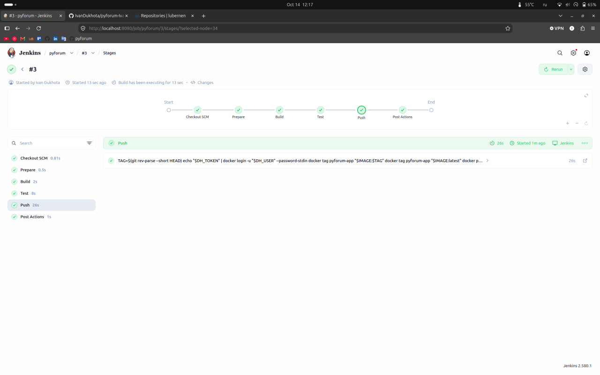
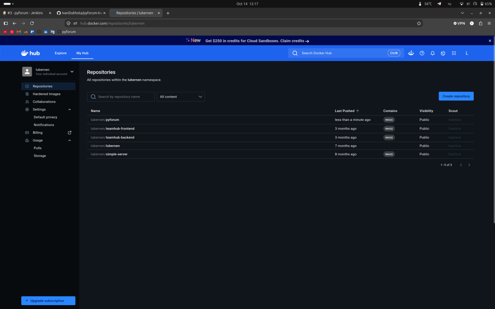

# DevOps Report:

## General Information:

- Period: 11.10.2026 - 14.10.2026
- Report date: 14.10.2026
- Author: Ivan Dukhota
- Project: PyForum
- Goal: Implement a CI/CD pipeline for PyForum with Jenkins

## Summary:

This report covers the third task, implementing CI/CD. First of all I started Jenkins in a Docker container on the same host and wrote a Jenkinsfile. The pipeline builds the app image, runs Django tests and pushes the image to Docker Hub. Jenkins checks remote repo every 5 minutes and starts a build when there are new commits.

## Goals:

- Main goal: automate build, test and delivery of the app image.
- Other goals: keep secrets in Jenkins credentials, tag every image with the commit hash.

## Architecture:

- Jenkins (custom image based on jenkins/jenkins:lts-jdk21 with Docker CLI, Compose and Buildx plugins, port 8080): runs separately from the app, with its own docker-compose.yml outside of the project.
- Jenkins uses host Docker daemon through docker.sock, so builds run on the host Docker.
- Jenkins_home is mounted from host on the same path, so paths in the workspace match for the host Docker daemon.
- Credentials: dockerhub (username and access token), pyforum-env (.env file as a secret file)/
- Job pyforum: pipeline from SCM, public GitHub repo, branch feature/ci-jenkins.

## Pipeline:

| Stage   | What it does |
| ------- | ------------ |
| Prepare | Copies .env from the pyforum-env secret file into the workspace |
| Build   | Builds the app image with docker compose build |
| Test    | Runs makemigrations and manage.py test in a one-off app container |
| Push    | Logs in to Docker Hub and pushes lubernen/pyforum with the short commit hash tag and latest |
| post    | Always runs docker compose down, removes .env and logs out from Docker Hub |

## Tasks Completed:

| #   | Task | Status | Owner | Finished | Notes |
| --- | ---- | ------ | ----- | -------- | ----- |
| 1   | Merged PR feature/docker into main | Done | Ivan | 13.10.2026 | - |
| 2   | Set up Jenkins in Docker with access to the host Docker daemon | Done | Ivan | 13.10.2026 | Separate compose file, outside the project |
| 3   | Created credentials (Docker Hub token, .env secret file) and the pipeline job | Done | Ivan | 13.10.2026 | - |
| 4   | Wrote Jenkinsfile with Prepare, Build, Test and Push stages, pollSCM trigger | Done | Ivan | 14.10.2026 | Branch feature/ci-jenkins |
| 5   | Checked the result: build #3 passed, 7 tests OK, image is on Docker Hub | Done | Ivan | 14.10.2026 | Tags 8221b13 and latest |

## Results:

- What I did: Jenkins pipeline that builds, tests and pushes the PyForum image.
- What I achieved: Every new commit in the branch is built and tested automatically, and a tested image is published to Docker Hub (lubernen/pyforum).

Jenkins build #3, all stages passed:

Docker Hub repository lubernen/pyforum after the push:

## Problems and Solutions:

| #   | Problem | Solution | Status |
| --- | ------- | -------- | ------ |
| 1   | Jenkins in a container needs Docker to build images | Installed Docker CLI in the Jenkins image, mounted docker.sock, added the docker group | Done |
| 2   | Host Docker daemon could not find files from the Jenkins workspace | Mounted JENKINS_HOME on the same path as on the host | Done |
| 3   | Migrations are in .gitignore, so tests had no migrations | Run makemigrations before tests in the Test stage | Done |
| 4   | Lint stage (black) failed: 17 of 34 files are not formatted | Removed the lint stage, did not change the app code in this task | Open |
| 5   | .env and Docker Hub token must not be in the repo | Stored them as Jenkins credentials, .env is removed after each build | Done |

## Next Steps:

- Open PR feature/ci-jenkins into main and switch the job to the main branch.
- Task 4: Implement Automatisation Setup a Webapp (Ansible).

## Tools and Technologies Used:

- Ubuntu 26.04: host OS.
- Jenkins (LTS, JDK 21): CI/CD server, declarative pipeline.
- Docker, Docker Compose: Jenkins container, app build and tests.
- Docker Hub: image registry.
- Django test runner: app tests.
- Git/GitHub: branches, pull requests, Conventional Commits.

## Comments and Conclusions:

The pipeline works end to end. The main challenge was running Docker from Jenkins inside a container.

## Appendix and Resources:

- Jenkins Pipeline syntax: https://www.jenkins.io/doc/book/pipeline/syntax/
- Jenkins in Docker: https://www.jenkins.io/doc/book/installing/docker/
- Docker Hub image: https://hub.docker.com/r/lubernen/pyforum
